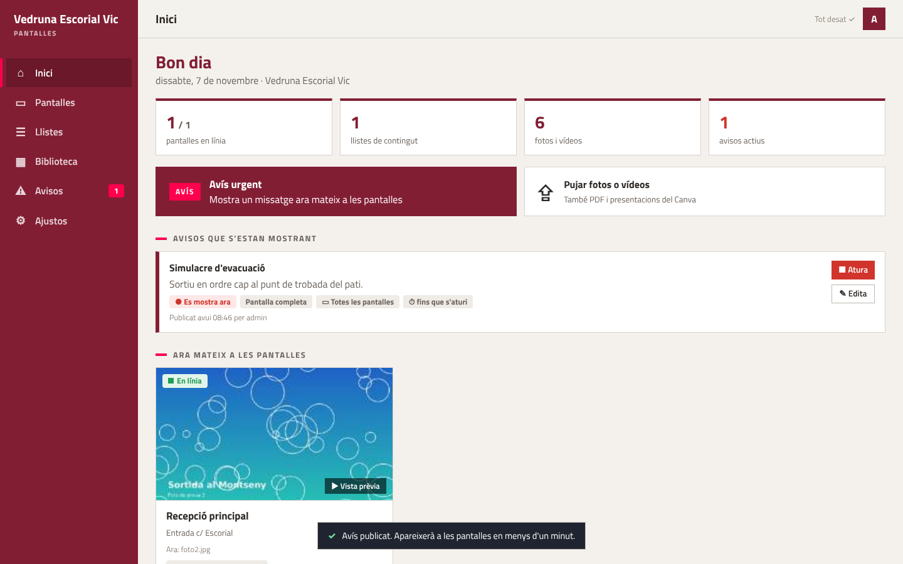
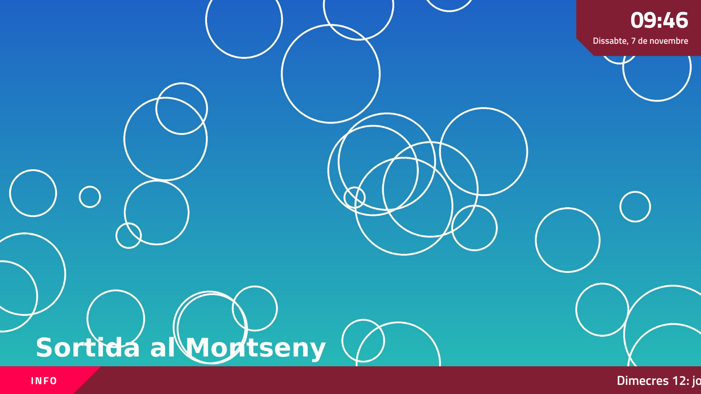
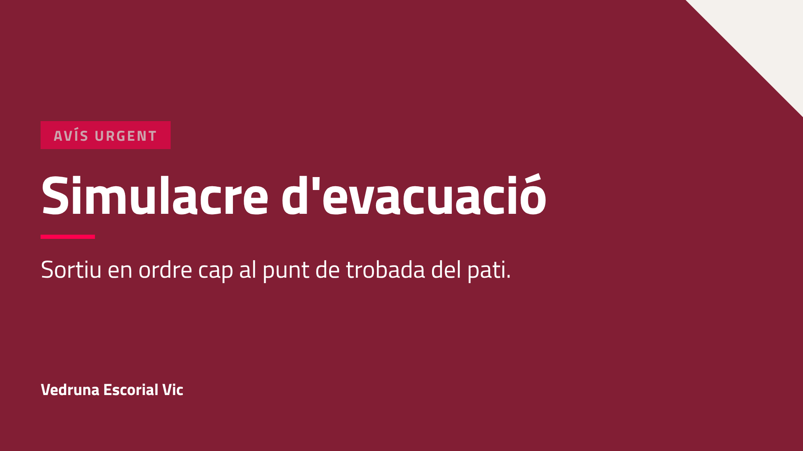
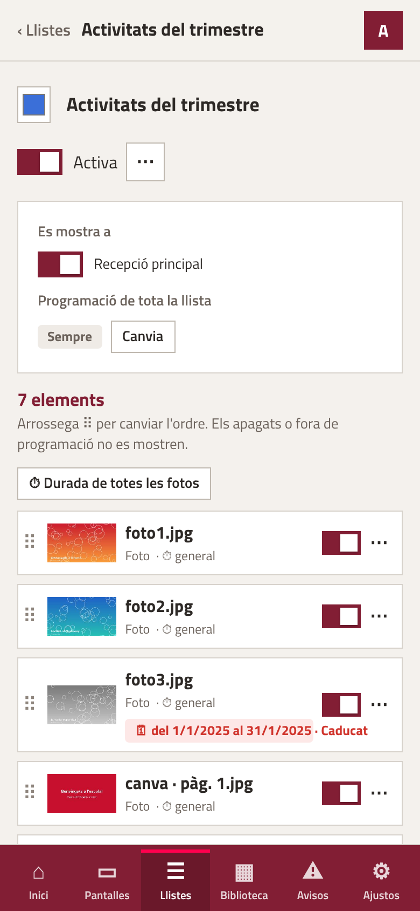
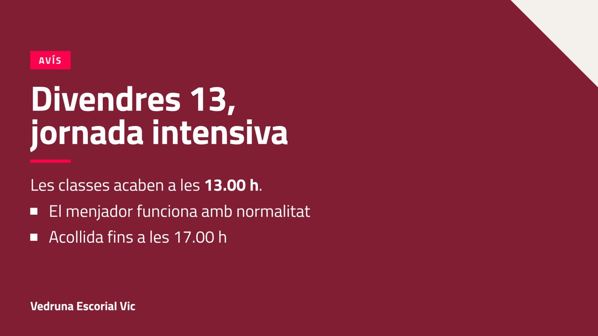
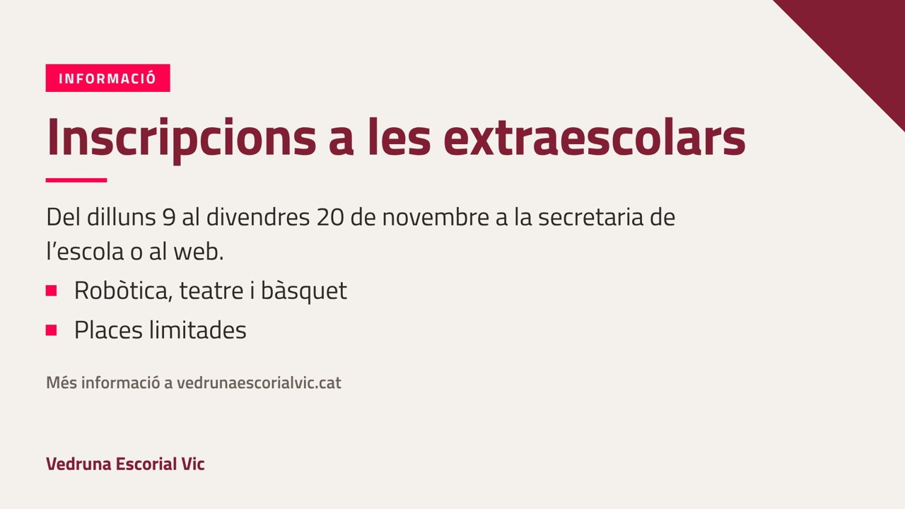
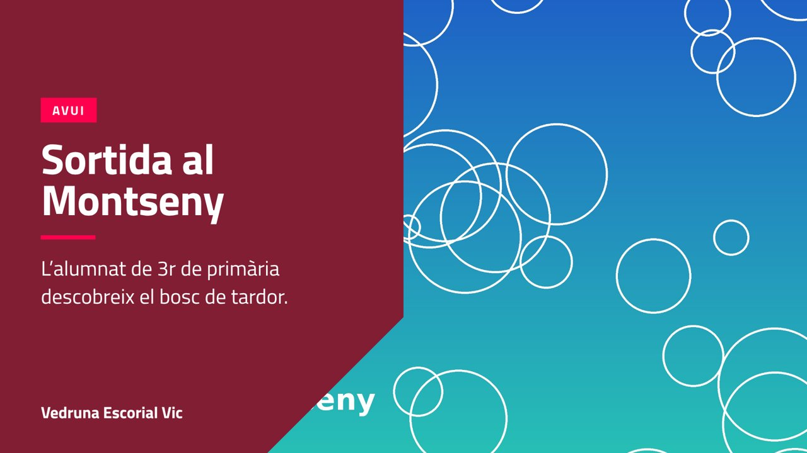
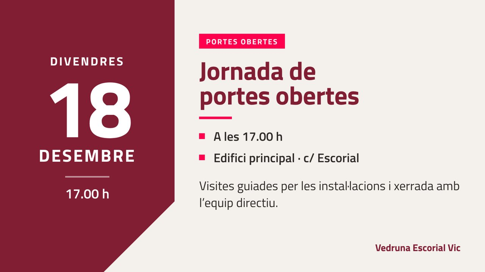
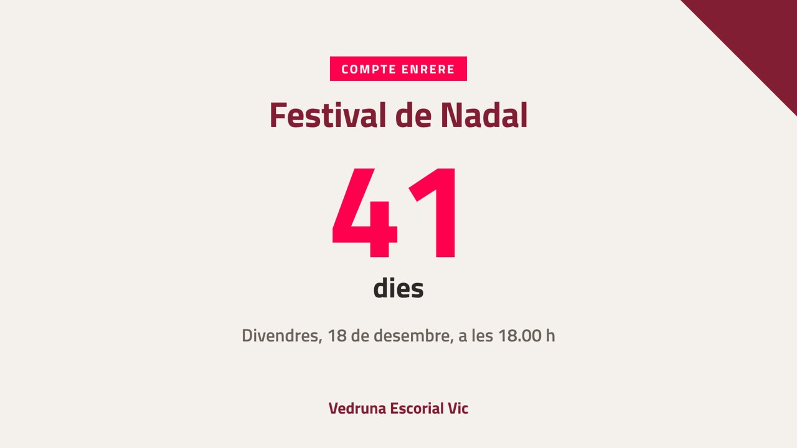
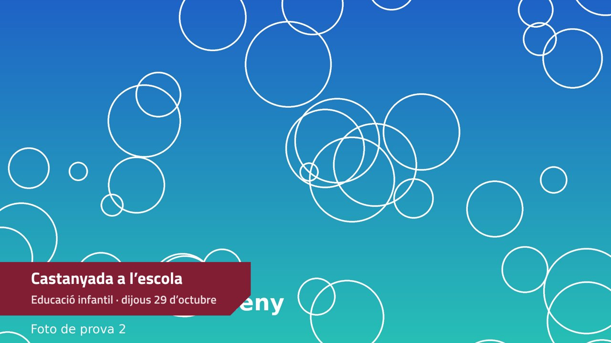

# Pantalles · Vedruna Escorial Vic

Sistema propi i gratuït per gestionar les pantalles informatives de l'escola (recepcions, passadissos…). Substitueix el NovoDS Studio: ja no cal l'ordinador de direcció, ni cap programa instal·lat, ni l'empresa externa.



## Què fa

- **Panell de control web** en català, des de qualsevol aparell: el mòbil, l'ordinador de casa o el de la feina. Hi entren només els correus autoritzats, amb un codi que arriba al correu.
- **Qualsevol tele, qualsevol marca**: només cal un navegador. Pot ser la Smart TV, un ordinador vell, un miniPC… Es vincula escrivint un codi de 6 xifres.
- **Tot tipus de contingut**:
  - fotos i vídeos;
  - **PDF del Canva**: cada pàgina és una diapositiva;
  - diapositives de text fetes al moment;
  - pàgines web;
  - YouTube;
  - rellotge;
  - compte enrere.
- **Llistes programables** per dates, dies i hores, amb contingut diferent a cada pantalla.
- **Avisos urgents** a pantalla completa o en banda, i una cinta de missatges.
- **Funciona sense xarxa**: cada pantalla guarda el contingut i el continua mostrant.
- **Vista prèvia** del que es veu a cada pantalla, estat en temps real i registre de qui fa cada canvi.
- **Privat**: les fotos són al Drive de l'escola, sense enllaços públics.
- **Cost 0 €**: Google Apps Script + Drive + GitHub Pages.

| Pantalla | Avís urgent | Mòbil |
|---|---|---|
|  |  |  |

## Plantilles amb la imatge de l'escola

| Avís destacat | Informació | Foto amb text |
|---|---|---|
|  |  |  |
| **Esdeveniment** | **Compte enrere** | **Peu de foto** |
|  |  |  |

`eines/mostrari.html?p=<plantilla>` mostra cada plantilla per revisar-ne el disseny.

## Documentació

- **[GUIA.md](GUIA.md)**: instal·lació pas a pas, com connectar cada tele i com fer-lo servir cada dia.
- **[CLAUDE.md](CLAUDE.md)**: context tècnic per continuar-lo desenvolupant.

## Estructura

| Carpeta | Què és |
|---|---|
| `apps-script/` | El servei (backend) que s'enganxa a script.google.com |
| `panell/` | El panell de control |
| `pantalla/` | El reproductor que s'obre a cada tele |
| `comu/` | Codi compartit (comunicació, diapositives) i llibreries incloses |
| `config.js` | **L'única cosa que cal configurar**: l'adreça del servei |
| `eines/` | Servidor de proves local i prova automàtica completa |

## Provar-ho a l'ordinador (sense Google)

```bash
node eines/servidor-proves.js        # → http://localhost:8080/panell/  (correu: admin@escola.cat, el codi surt a la consola)
node eines/prova-e2e.js <carpeta-amb-foto1.jpg,foto2.jpg,foto3.jpg,canva.pdf,video.webm> docs/captures
```

El servidor de proves executa el codi real d'Apps Script amb imitacions de Google (Drive, correu, memòria cau).
